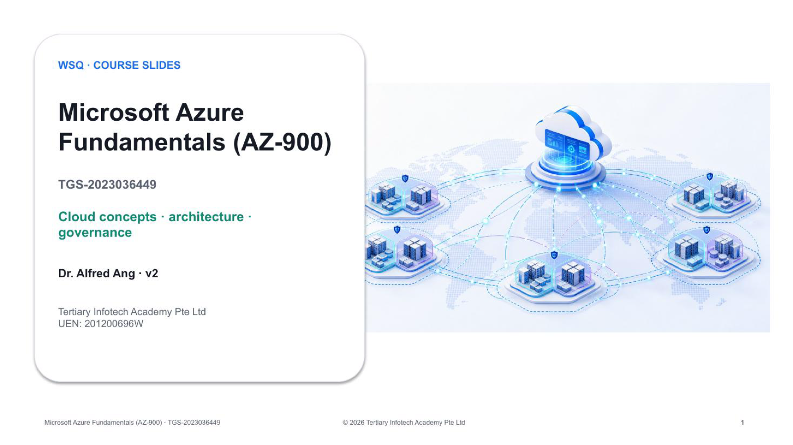

# Microsoft Azure Fundamentals (AZ-900)

Official learner-facing course repository for the two-day, 16-hour WSQ course delivered by [Tertiary Infotech Academy Pte Ltd](https://www.tertiarycourses.com.sg/wsq-microsoft-azure-fundamentals-az-900.html).

- Course code: `TGS-2023036449`
- Current courseware: version 2, aligned to the AZ-900 skills measured from 20 July 2026
- Registration: [WSQ Microsoft Azure Fundamentals (AZ-900)](https://www.tertiarycourses.com.sg/wsq-microsoft-azure-fundamentals-az-900.html)
- Funding: up to 70% for eligible Singapore Citizens and Permanent Residents, subject to prevailing eligibility and funding rules

## Learning outcomes

Learners will be able to:

1. Assess cloud solutions and specifications for Azure cloud computing.
2. Develop an implementation plan for Azure cloud computing.
3. Develop review processes to resolve Azure cloud implementation issues.

## Courseware

| Artifact | File |
|---|---|
| Editable trainer slides | [Microsoft Azure Fundamentals (AZ-900)-v2.pptx](courseware/Microsoft%20Azure%20Fundamentals%20%28AZ-900%29-v2.pptx) |
| Learner slide PDF | [Microsoft Azure Fundamentals (AZ-900)-v2.pdf](courseware/Microsoft%20Azure%20Fundamentals%20%28AZ-900%29-v2.pdf) |
| Learner Guide | [LG-Microsoft Azure Fundamentals (AZ-900).docx](courseware/LG-Microsoft%20Azure%20Fundamentals%20%28AZ-900%29.docx) |
| Lesson Plan | [LP-Microsoft Azure Fundamentals (AZ-900).docx](courseware/LP-Microsoft%20Azure%20Fundamentals%20%28AZ-900%29.docx) |
| Lab index | [labs/README.md](labs/README.md) |

The trainer artifact is the editable PPTX. Detailed click paths, commands, troubleshooting and acceptance checks are in the Learner Guide and individual labs, not in the slides.

## Lab catalogue

### Describe cloud concepts

- [Lab 1 — Tour the Azure Portal and create a resource group](labs/lab-01-azure-portal-tour/)
- [Lab 2 — Use Azure Cloud Shell, CLI and PowerShell](labs/lab-02-cloud-shell-cli/)
- [Lab 3 — Explore regions, region pairs and availability zones](labs/lab-03-regions-availability-zones/)

### Describe Azure architecture and services

- [Lab 4 — Create a Windows virtual machine](labs/lab-04-windows-vm-portal/)
- [Lab 5 — Create a Linux virtual machine with Azure CLI](labs/lab-05-linux-vm-cli/)
- [Lab 6 — Create an App Service web app](labs/lab-06-app-service-webapp/)
- [Lab 7 — Deploy Azure Container Instances](labs/lab-07-container-instances/)
- [Lab 8 — Build a virtual network and test private connectivity](labs/lab-08-virtual-network/)
- [Lab 9 — Use Azure Storage and Blob Storage](labs/lab-09-storage-blobs/)
- [Lab 10 — Create an Azure SQL Database](labs/lab-10-azure-sql/)
- [Lab 11 — Work with Microsoft Entra ID users and groups](labs/lab-11-entra-id/)

### Describe Azure management and governance

- [Lab 12 — Manage access with Azure RBAC](labs/lab-12-rbac/)
- [Lab 13 — Apply resource tags and locks](labs/lab-13-tags-locks/)
- [Lab 14 — Enforce standards with Azure Policy](labs/lab-14-azure-policy/)
- [Lab 15 — Estimate and control Azure costs](labs/lab-15-cost-management/)
- [Lab 16 — Use Advisor, Service Health and Azure Monitor](labs/lab-16-monitoring/)

## Public/private boundary

This public repository contains learner-facing courseware and labs only. Candidate assessment papers, answer keys, publication credentials, QA output and private build sources are excluded.

## References

- [Official AZ-900 study guide](https://learn.microsoft.com/en-us/credentials/certifications/resources/study-guides/az-900)
- [Official Microsoft Learn practice assessment](https://learn.microsoft.com/en-us/credentials/certifications/azure-fundamentals/practice/assessment?assessment-type=practice&assessmentId=23)
- [MicrosoftLearning AZ-900 labs](https://github.com/MicrosoftLearning/AZ-900-Microsoft-Azure-Fundamentals)

Always verify the active subscription and region before creating resources, use the smallest suitable SKUs, and complete each lab's cleanup gate.
